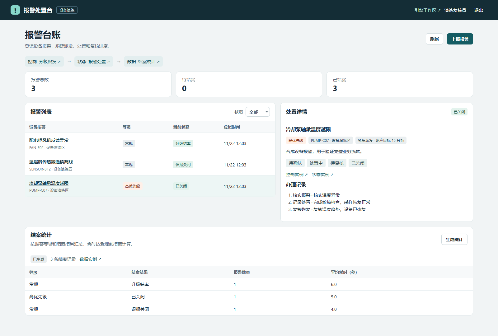
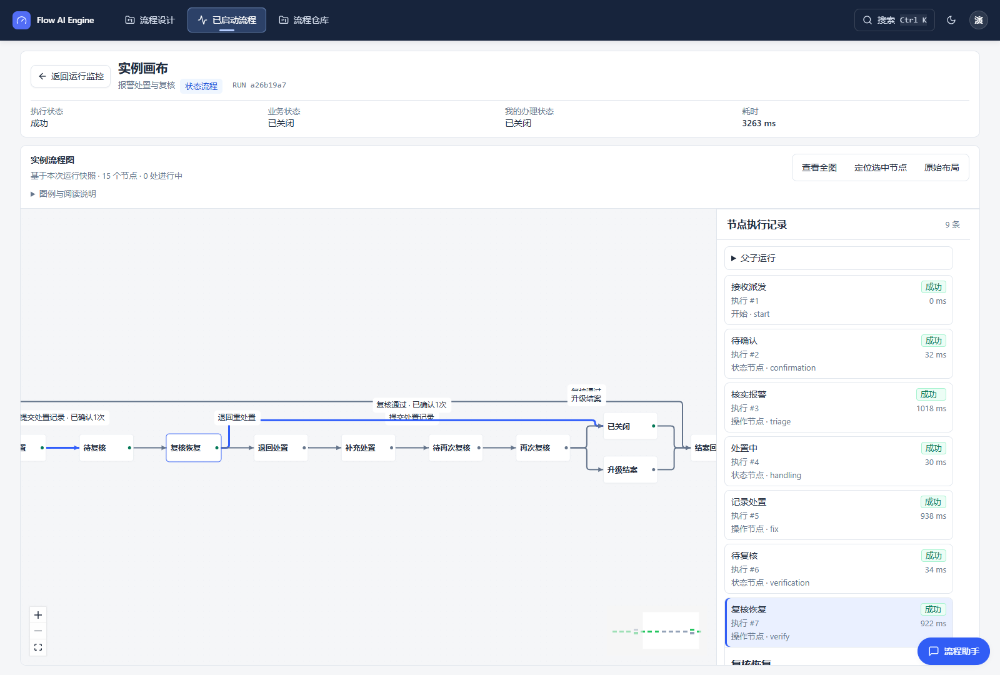

# 设备报警处置演练

独立桌面网页业务应用。设备报警通过 Flow AI Engine 分级派发、办理、复核和统计。示例输入为合成设备事件，适合验证业务系统与流程引擎的集成。

[对接 Flow AI Engine](docs/flow-engine-integration.md) · [架构与部署](docs/architecture.md) · [实际验收记录](docs/acceptance.md)

## 演示截图与办理过程

截图来自独立测试项目中的实际运行。复验时使用部署者发放的演练值班员、处置员和复核员账号。保留各角色独立会话，或者退出后切换账号。

1. 值班员选择「上报报警」，填入温度越限或通信离线样例，再提交。控制流程根据等级启动对应处置路径。值班员确认属实或填写原因关闭误报。
2. 处置员填写处置记录并提交。复核员填写复核意见，可以关闭，也可以退回补充处置。再次复核可关闭或升级结案。
3. 复核员选择「生成统计」。数据流程读取实际结案快照，按等级和结案结果汇总数量及平均耗时。每份统计都有可打开的引擎实例。

## 三种流程

| 类型 | 演练定义 | 执行结果 |
| --- | --- | --- |
| 控制 | 报警分级与派发 | 高优先级走紧急派发，常规走常规派发。父实例等待固定版本的处置子实例并接收结案回执。 |
| 状态 | 报警处置与复核 | 值班确认、处置、复核、补充处置和结案由引擎保存并分派。 |
| 数据 | 报警处置统计 | 读结案快照、校验、分组聚合并保存数据节点产物。 |

## 本地启动

需要 Node.js 20 或更新版本，以及一套支持持久子流程的 Flow AI Engine 环境。按指南创建演练账号、发布三类流程并启动服务，再打开本机处置台。指南包含独立业务系统如何调用引擎、如何办理和如何回读结果。[配置、启动及接口示例](docs/flow-engine-integration.md)

## 复验

`npm test` 运行演示项目测试。`npm run acceptance` 在指定的演练台账中提交三条合成报警，办理后核对父子结果、报表源数据和血缘。[验收命令](docs/flow-engine-integration.md#6-运行验收或换成自己的业务) · [实测结果](docs/acceptance.md)

依赖的流程引擎采用其仓库中的[许可文件](https://github.com/Azurefly/flow-ai-engine/blob/main/LICENSE)。
