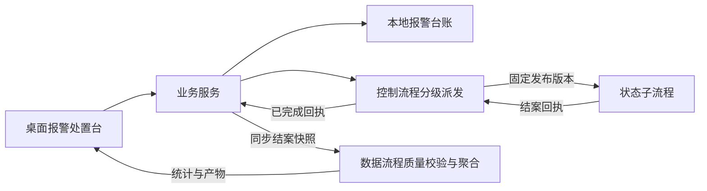

# 架构与部署

## 数据和执行权

业务服务保存报警编号、原始字段和引擎实例关联。报警编号作为幂等键，响应中断时沿用原编号。流程引擎保存正式状态、审批意见、父子关系、运行节点及数据产物。控制实例和状态子实例均成功且业务结案回执一致后，台账才记为结案。

会话由 Flow AI Engine 发放。演练应用复用账号身份，通过独立的 HttpOnly Cookie 保存会话，按当前项目权限展示功能。待办动作来自引擎当前任务结果配置。值班、处置和复核由三个演练账号完成，复核账号另有该测试项目的设计者权限以同步报表快照。

报表取台账中已核对的结案记录。业务服务把快照写入该演练项目的「报警结案快照」资源，串行提交真实数据运行，回读源节点的行及摘要，再显示引擎返回的分组结果。行数上限 200。使用一个 Demo 实例维护一份台账和统计快照，状态文件应挂载为持久目录。

紧急与常规分支分别带 15 分钟与 60 分钟的响应目标。响应目标用于演练展示。复核退回允许一次补充处置，第二次复核可以升级结案。

## 运行配置

| 变量 | 用途 | 默认值 |
| --- | --- | --- |
| `ALARM_CONFIG_FILE` | `provision` 生成的项目、流程、账号数字 ID 和资源配置 | `runtime/setup/config.json` |
| `ALARM_LEDGER_FILE` | 持久报警与统计台账 | `runtime/ledger.json` |
| `ALARM_PORT` | 应用端口 | `8080` |
| `ALARM_BIND` | 本机进程监听地址，容器镜像设为 `0.0.0.0` | `127.0.0.1` |
| `ALARM_PUBLIC_ORIGIN` | 浏览器使用的同源地址 | `http://127.0.0.1:8080` |
| `ALARM_BASE_PATH` | 网页、静态文件和 API 前缀 | `/alarm-demo` |

容器部署可用 `docker build -t alarm-response-demo .` 构建。将 `config.json` 只读挂载到容器，并为台账目录设置容器用户可写的持久卷。HTTPS 反向代理保留 URL 前缀，转发到本机回环端口。

使用已有的 Flow AI Engine HTTPS 站点时，可以把演示服务挂在 `/alarm-demo/`。在远程 Linux 服务器的 Bash 中运行 `scripts/remote-host-deploy.sh`，参数依次为已有 Node 镜像、Demo 源码目录、包含 `config.json` 和 `ledger/` 的状态目录及站点 HTTPS origin。该脚本适用于使用 `/etc/nginx/conf.d/flow-ai-engine-https.conf` 的部署。[初始化与联验](flow-engine-integration.md)

管理员账号只在 `provision` 执行期间使用。演练账号文件由部署者限制访问，和业务台账分开保存。使用合成设备事件验证流程和统计。
